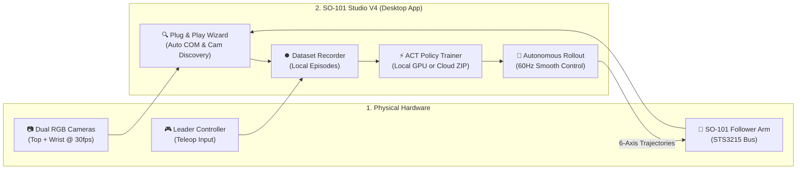

<div align="center">

<!-- Replace the image path below with your actual product photo in assets/hero_arm.png -->


# 🦾 Robot-i | SO-101 Embodied AI Robotic Arm

**Commercial-Grade, Plug-and-Play 6-DOF Imitation Learning Manipulator & Desktop Control Suite**

[](https://www.python.org/)
[](https://pytorch.org/)
[](https://github.com/huggingface/lerobot)
[](#)
[](#)

[Overview](#-overview) • [Live Demo](#-autonomous-ai-in-action) • [Hardware Specs](#-hardware-specifications) • [Quick Start](#-out-of-the-box-quick-start) • [Architecture](#-system-architecture) • [Versions](#-repository-structure)

</div>

---

## 🌟 Overview

The **Robot-i SO-101** is a complete, ready-to-deploy **6-DOF Embodied AI Robotic Arm** engineered for research labs, industrial automation prototyping, universities, and robotics developers.

Instead of writing rigid, hardcoded inverse-kinematics scripts for every single object position, the **Robot-i SO-101** learns directly from human demonstrations using **Action Chunking with Transformers (ACT)** and dual-camera real-time computer vision.

To ensure a zero-friction experience out of the box, every unit ships with **SO-101 Studio V4**—our standalone desktop software suite that automates environment installation, USB port/camera discovery, calibration, dataset recording, neural network training, and **60 Hz smooth autonomous execution** with a single click.

---

## 🎥 Autonomous AI in Action

<div align="center">

<!-- Replace assets/demo_pick_place.gif with a GIF converted from your test video -->


*Autonomous Pick-and-Place powered by an ACT visuo-motor policy trained on 50 human demonstrations — adapting dynamically to varying object orientations in real time.*

</div>

---

## ⚙️ Hardware Specifications

| Subsystem | Specification | Details |
| :--- | :--- | :--- |
| **Degrees of Freedom** | **6-DOF + Gripper** | Base, Shoulder, Elbow, Wrist Pitch, Wrist Roll, and Precision Parallel Gripper |
| **Actuators** | **Feetech STS3215** | Smart serial bus servos (`1,000,000 baud`) with real-time position, load & voltage feedback |
| **Vision System** | **Dual RGB Cameras** | Overhead Workspace Camera (`top`) + Eye-in-Hand Gripper Camera (`wrist`) @ `640×480, 30 FPS` |
| **Teleoperation** | **Leader-Follower** | 1:1 kinematic Leader arm (supports Servo Bus or ultra-low-latency **ESP32-C3 + AS5600** magnetic encoders) |
| **Control Cadence** | **Up to 60 Hz** | `30 Hz` neural policy inference with `2x` linear trajectory interpolation for jitter-free motion |
| **Compute Support** | **PC & Edge Ready** | Full NVIDIA CUDA (`TF32`) acceleration on Windows/Linux + lightweight deployment on **Raspberry Pi** |
| **Power Supply** | **12V DC** | Regulated 12V power input for high-torque continuous operation |

---

## 🧠 System Architecture



---

## 🚀 Out-of-the-Box Quick Start

Setting up your **Robot-i SO-101** on a brand-new Windows PC or Linux / Raspberry Pi machine takes less than 5 minutes—no manual Python or Conda setup required.

### Step 1: Download the Software
Clone this repository (or download and extract the ZIP):
```bash
git clone https://github.com/FATHEY12352/robot-i.git
cd robot-i/v4
```

### Step 2: Launch **SO-101 Studio V4** (1-Click Bootstrap)
* **On Windows:** Double-click **`start_v4.bat`** inside the `v4` folder.
* **On Linux / Raspberry Pi:**
  ```bash
  chmod +x start_v4.sh
  ./start_v4.sh
  ```
> **What happens automatically:** The launcher creates an isolated Python virtual environment (`v4/.venv`), detects your NVIDIA GPU / CUDA or CPU architecture, and opens the **SO-101 Studio V4** graphical interface.

### Step 3: Follow the 5-Tab Workflow Inside the App

<div align="center">
<!-- Replace assets/studio_gui.png with a screenshot of your SO-101 Studio V4 app -->

</div>

1. **Environment & Health Check:** Click **"Install / Repair Full Robotics Environment"** on first run to automatically provision PyTorch and LeRobot.
2. **Hardware & Dual-Cam Wizard:** Choose **Guided Auto-Discovery** (plug in Follower, Leader, Top Camera, and Wrist Camera one by one) and verify both live camera feeds side-by-side.
3. **Record Demonstrations:** Enter your task name (e.g., `"Pick and place"`), set the number of episodes (recommended: `30–50`), and demonstrate the task using the Leader arm.
4. **Train Your AI Policy (ACT):**
   * **Local GPU Training:** Train directly on your workstation with `TF32` acceleration enabled.
   * **Cloud GPU Export:** Click **"Prepare & Compress Dataset for Cloud GPU"** to generate a ready-to-upload `.zip` package for remote RTX 4090 / A100 training, then import the trained checkpoint back in one click.
5. **Autonomous Rollout:** Select your trained model and click **"Start Autonomous Robot"** to watch your SO-101 execute the task independently. Press `Ctrl + C` at any time to safely return the arm to its home pose.

---

## 📂 Repository Structure

| Folder | Description |
| :--- | :--- |
| **`v4/`** | **Current Flagship Release — SO-101 Studio V4** (GUI App, 1-Click Bootstrappers, Hardware Wizard, Cloud Packager & Docs) |
| **`V3/`** | Optimized CLI pipeline with `TF32` ACT training configurations and `60 Hz` rollout benchmarks |
| **`V2/`** | Core LeRobot v0.7.0+ integration, dual-camera calibration, and initial policy inference scripts |
| **`V1/` & `V1 Amazing Hand/`** | Early mechanical prototypes, kinematic studies, and custom end-effector R&D |

---

## 🛠️ Safety & Troubleshooting Tips

* **Emergency Stop & Safe Return:** During autonomous rollout, pressing `Ctrl + C` in the active console smoothly interpolates the arm back to its initial startup position before releasing motor torque.
* **USB Port Re-enumeration:** If you plug the arm into a different USB port on Windows, simply open **Tab 2 (Hardware Wizard)** in Studio V4 and click **Scan Ports** to update your profile in seconds.
* **Magnet & Encoder Alignment (Leader Arm):** If using magnetic rotary encoders (`AS5600`), maintain an air gap of **1.5 mm – 2.0 mm** between the diametrically magnetized magnet and the sensor IC for optimal signal strength.

---

<div align="center">

### 🤝 Built by **Robot-i**

For hardware inquiries, custom gripper designs, or enterprise/lab deployments, open an issue in this repository or contact our engineering team.

</div>